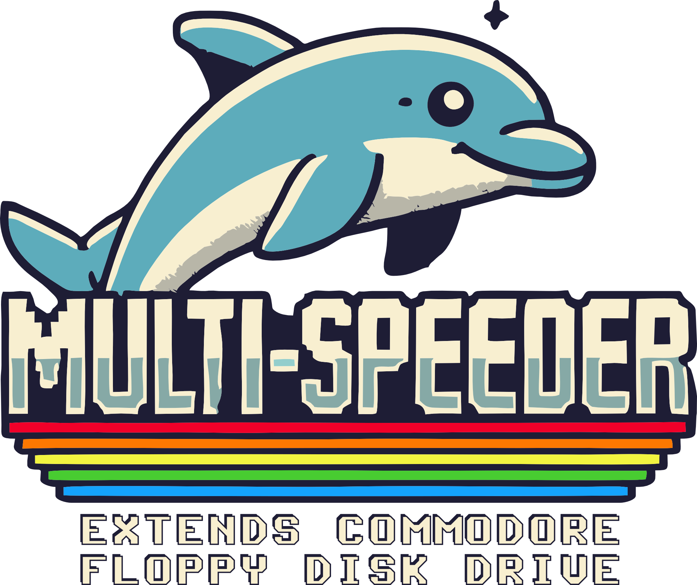
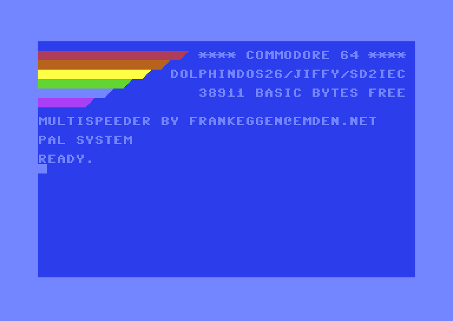
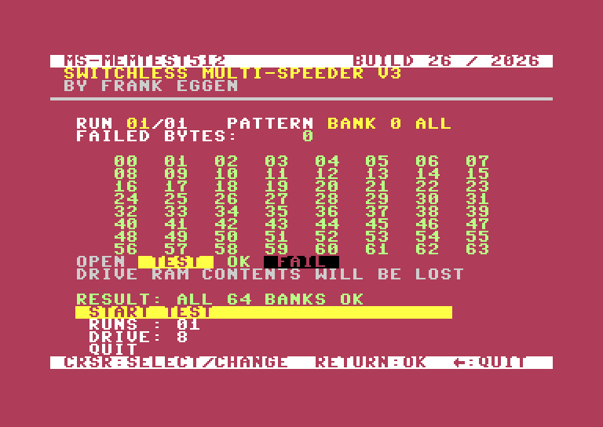
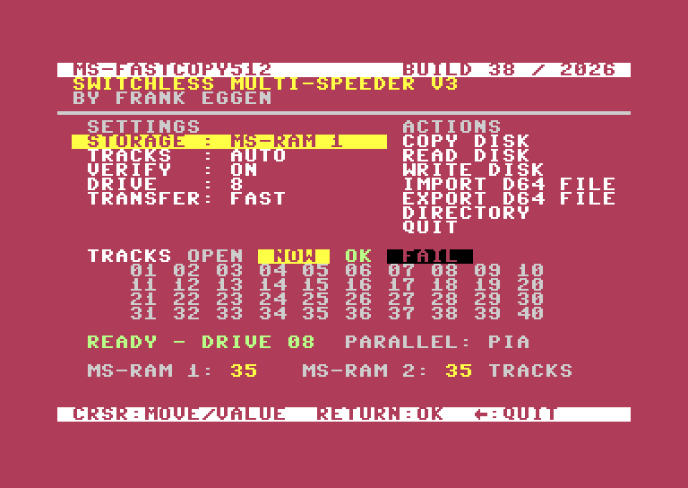
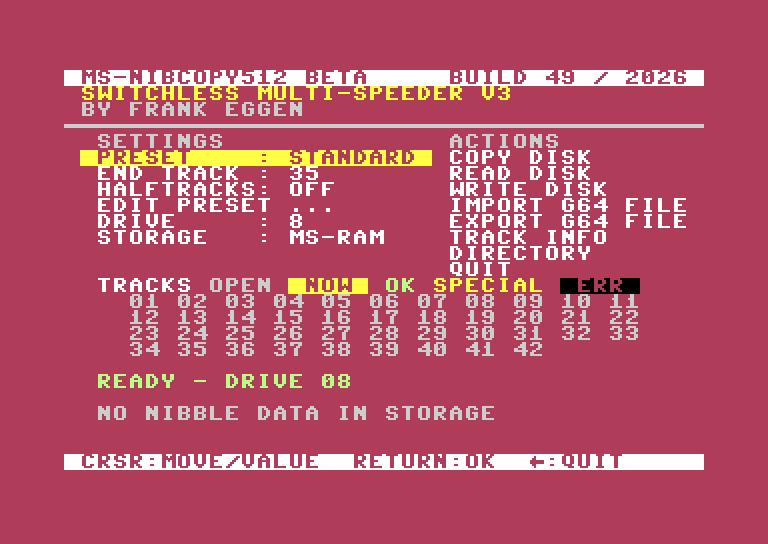
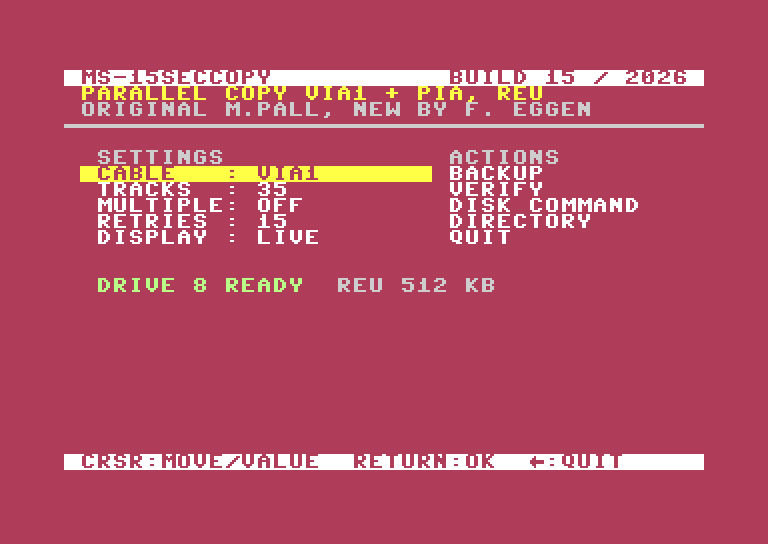

<p align="center"></p>

# DolphinDos26

**Drive firmware, C64 kernal and tools for the Commodore 1541, the 1541 Switchless 8x Multi-Floppy-Speeder V3 and the Commodore 64 Ultimate.**

**Language:** [English](#english) · [Deutsch](#deutsch)

| | English | Deutsch |
|---|---|---|
| Multi-Speeder V3 manual | [PDF](manuals/en/DolphinDos26_Manual.pdf) | [PDF](manuals/de/DolphinDos26_Handbuch.pdf) |
| C64 Ultimate / DolphinDOS 2 hardware manual | [PDF](manuals/en/DolphinDos26UL_Manual.pdf) | [PDF](manuals/de/DolphinDos26UL_Handbuch.pdf) |
| JiffyDOS manual (JiffyDOS 6.01, new edition) | [PDF](manuals/en/JiffyDOS_Manual.pdf) | [PDF](manuals/de/JiffyDOS_Handbuch.pdf) |
| Technical notes | [docs/en](docs/en) | [docs/de](docs/de) |

> **Status:** The C64 kernal, also as C64 II ROM, the DolphinDos26 and DolphinDos26DD2 firmware for the 1541 Multi-Speeder and MS-FASTCOPY512 run on real hardware. Reports from real hardware are very welcome.

---

# English

## What is this?

DolphinDos26 (DD26) is a further development of **DolphinDOS 3.0** by Günther Jilg and Jan Bubela. The number stands for the year 2026. It stays compatible in daily use with DolphinDOS 3.0: parallel transfer, track cache, the `@` and `X` commands, the 40-track format and the function keys work as before.

The project consists of five parts:

| Part | What it does | Runs on |
|---|---|---|
| **DolphinDos26** | Drive firmware that uses the 512 KB RAM of the Multi-Speeder | 1541 with Switchless Multi-Speeder V3 |
| **DolphinDos26UL** | Reduced firmware with the parallel cable on VIA1 | C64 Ultimate; real 1541 with DolphinDOS 2 hardware |
| **DolphinDos26DD2** | All functions of DolphinDos26, but with the parallel cable on VIA1 like DolphinDos26UL | 1541 with Switchless Multi-Speeder V3 |
| **C64DolphinDos26** | C64 kernal that combines DolphinDOS parallel, JiffyDOS and standard serial | C64, C64 II, and C128 in C64 mode |
| **MS-Tools** | C64 programs for testing and copying | C64 mode, with the firmware above |

<p align="center"></p>

## Which files do I need?

| Your hardware | Drive ROM | C64 kernal | Manual |
|---|---|---|---|
| **1541 with Switchless Multi-Speeder V3** (512 KB, 6821 PIA) | [`1541DolphinDos26.bin`](rom/1541DolphinDos26.bin) | [`C64DolphinDos26.bin`](rom/C64DolphinDos26.bin) | [Manual](manuals/en/DolphinDos26_Manual.pdf) |
| **Commodore 64 Ultimate** (emulated drive) | [`C1541_DOLPHINDOS26UL.bin`](rom/C1541_DOLPHINDOS26UL.bin) | [`C64DolphinDos26.bin`](rom/C64DolphinDos26.bin) | [UL manual](manuals/en/DolphinDos26UL_Manual.pdf) |
| **Real 1541 with DolphinDOS 2 hardware** (VIA1 cable, 8 KB RAM) | [`C1541_DOLPHINDOS26UL.bin`](rom/C1541_DOLPHINDOS26UL.bin) | [`C64DolphinDos26.bin`](rom/C64DolphinDos26.bin) | [UL manual](manuals/en/DolphinDos26UL_Manual.pdf) |
| **1541 with Switchless Multi-Speeder V3 and SpeedDOS-style cable** (512 KB, VIA1 cable) | [`C1541_DOLPHINDOS26DD2.bin`](rom/C1541_DOLPHINDOS26DD2.bin) | [`C64DolphinDos26.bin`](rom/C64DolphinDos26.bin) | [Manual](manuals/en/DolphinDos26_Manual.pdf), chapter 8; differences in the [firmware notes](docs/en/firmware-source-notes.md#dolphindos26dd2-multi-speeder-v3-with-speeddos-parallel-cable) |

**C64 II (short board):** BASIC and kernal share one ROM chip. Use [`C64IIDolphinDos26.bin`](rom/C64IIDolphinDos26.bin) (16 KB) there instead of `C64DolphinDos26.bin`. It holds the unchanged BASIC 901226-01 at offset `$0000` and the kernal at offset `$2000`.

> **The drive ROMs are not interchangeable.** DolphinDos26 transfers over the PIA of the Multi-Speeder, DolphinDos26UL and DolphinDos26DD2 over VIA1. With the wrong ROM the parallel transfer hangs.

## Features

### DolphinDos26 (Multi-Speeder V3)

- Read whole disks (35 or 40 tracks) into the drive RAM and write them to any number of target disks without transferring data to the C64 (`CDR`/`CDW`).
- A RAM disk: drive 8 works directly from memory (`CDM1`/`CDM2`).
- Faster read and write routines, faster write-back of the directory track, real error messages instead of blanket errors.
- A fixed programming interface for C64 programs (MS-Addon-API).

### C64DolphinDos26 kernal

- Three protocols in one kernal: DolphinDOS parallel, JiffyDOS and standard serial. For each access it picks the fastest method the addressed device supports, without any switching.
- Shows the transfer type while loading: `LOADING DD:` for DolphinDOS parallel, `LOADING JF:` for JiffyDOS.
- Function keys for SD2IEC to change directories and disk images and to load directly from the directory.
- Saves and loads game states of programs with their own interrupt handler completely (for example Eye of the Beholder), which the original DolphinDOS 2/3 kernal aborts.

### DolphinDos26UL

- Parallel transfer on the C64 Ultimate, which only emulates the SpeedDOS-style cable on VIA1, using the parallel routines of DolphinDOS 2.0.
- Clean cold start even if the drive RAM holds random values at power-on.
- Fixed head phase when formatting.
- No soldering and no EPROM programmer on the C64 Ultimate: drive ROM, kernal, drive RAM and cable are set in its menu.

## MS-Tools

The disk image [`ms-tools.d64`](ms-tools/ms-tools.d64) holds all tools; `MS-15SECCOPY` is also available on its own disk [`ms-15seccopy.d64`](ms-tools/ms-15seccopy.d64). The single programs are also in [`ms-tools/prg`](ms-tools/prg). Each one loads like a BASIC program:

```
LOAD"MS-STATUS",8
RUN
```

| Tool | Build | Purpose |
|---|---|---|
| `MS-STATUS` | 23 | Shows the drive error channel |
| `MS-MEMTEST512` | 26 | Tests the 512 KB SRAM (64 banks) with 4 patterns, 1 to 99 runs, result per bank |
| `MS-FASTCOPY512` | 38 | Disk copy through the 512 KB RAM or a REU (`TRANSFER: FAST` with its own fast drive code), 35/40/auto tracks, verify on/off, several copies, directory view, D64 file import and export |
| `MS-NIBCOPY512` | 49 (BETA) | Nibble copier after the model of nibtools: reads and writes tracks bit by bit (syncs, gaps, tracks 36 to 42, half tracks, weak bits), storage in the Multi-Speeder RAM or a REU, G64 import and export |
| `MS-RS232` | 3 | RS-232 driver in RAM at $9800 to $9FFF, because the kernal has no RS-232 routines |
| `MS-15SECCOPY` | 16 | New version of 15 Seconds Copy by Mike Pall: copies normally formatted disks as raw GCR over the parallel cable |

`MS-MEMTEST512` needs the Multi-Speeder. `MS-FASTCOPY512` works without it if there is a REU of at least 256 KB and a parallel connection (PIA or VIA1), for example with DolphinDos26UL. The raw driver [`RS232DRV-9800.prg`](ms-tools/prg/RS232DRV-9800.prg) is included as well.

`MS-15SECCOPY` (Build 16) is a new version of **15 Seconds Copy**, written by **Mike Pall** in 1986. It copies normally formatted disks as raw GCR over the parallel cable and shows every track and sector in a grid. Minimum requirements: a REU of at least 256 KB (512 KB for 40 tracks) and a parallel cable on VIA1 or on the PIA, with a 1541 as device 8. The original 1541 ROM and the original kernal are enough; DolphinDos26 and the Multi-Speeder are not needed. On real hardware (C64U, 1541, REU), BACKUP and VERIFY ran over all 683 blocks without errors, on VIA1 under DolphinDOS 2.0 and on the PIA under DolphinDos26DD2, with source and target being the same disk; 35 tracks took at most 12 s reading and 18 s writing. The REU is used as a buffer, so data stored there may be overwritten.

> **MS-NIBCOPY512 is a BETA version** and is being developed further; functions and operation can still change. It needs the MS-RAM of the Multi-Speeder or a REU and an active parallel connection, and it has not been tested with DolphinDOS 2.

<p align="center">




</p>

## Performance

Measured in the VICE emulator (C64 PAL, 1541 with Multi-Speeder, real time). Real hardware may differ.

| Operation | Time |
|---|---|
| Load 30 KB program, parallel (DolphinDOS) | 3.7 s |
| Load 30 KB program, serial (CBM kernal) | 66 s |
| Load 30 KB program from the RAM disk | 1.2 s |
| Save 30 KB program, disk / RAM disk | 7.3 s / 1.9 s |
| Read disk (35 tracks) into RAM, `CDR1` | 22.9 s |
| Write RAM to disk with verify, `CDW1` | 26.3 s |

Program with 16,000 bytes, by protocol (also measured in VICE):

| Operation | DolphinDos26 parallel | JiffyDOS (1541) | Standard DOS |
|---|---|---|---|
| LOAD | 2.1 s | 6.7 s | 41.2 s |
| SAVE | 4.6 s | 19.1 s | 48.4 s |

## Installation in short

**Multi-Speeder V3:** Put `1541DolphinDos26.bin` (64 KB) into bank 8 of your 512 KB EPROM image (the last 64 KB, offset `$70000`), program a 27C040 or 29F040 and fit it. Switch with `@I:8@RNROM`. The drive then reports `73, DOLPHINDOS26 1541`. Fit `C64DolphinDos26.bin` as the C64 kernal.

**Multi-Speeder V3 with SpeedDOS-style cable:** As above, but with `C1541_DOLPHINDOS26DD2.bin` as bank 8. The drive then reports `73, DOLPHINDOS26  DD2`. At every drive reset the PIA data port and CA2 are inputs, so its lines may run 1:1 parallel to the cable.

**C64 II:** Program `C64IIDolphinDos26.bin` (16 KB) and fit it in place of the combined BASIC/kernal ROM.

**C64 Ultimate:** Copy both files to a USB stick or SD card. In the menu set for drive A: on, type 1541, device 8, 1541 ROM `C1541_DOLPHINDOS26UL.bin`, 8 KB RAM at $6000 to $7FFF, parallel cable on. Select `C64DolphinDos26.bin` as the kernal, save and cold start. `@` then shows `73,DOLPHINDOS26 C64U,00,00`.

Full steps and troubleshooting are in the manuals.

## Known limits

- The C64 kernal, also as C64 II ROM, the DolphinDos26 and DolphinDos26DD2 firmware and MS-FASTCOPY512 (also with REU storage and with the original DolphinDOS 2.0) run on real hardware. Whether a real SD2IEC accepts `.D64` as a plain file has not been checked. The case of a write-protected target disk with `CDW` is untested.
- The content of the 512 KB RAM survives a drive reset, but not power-off.
- Colors: the kernal uses the colors of the original C64 ROM. Border, background and text are single ROM bytes ($ECD9, $ECDA, $E535), see [Personalization](docs/en/c64-kernal.md#personalization).
- `MS-MEMTEST512` overwrites the RAM content.
- Programs with their own fast loader or copy protection sometimes only run with the original kernal and original DOS.
- DolphinDos26 uses illegal NMOS 6502 instructions like DolphinDOS, so it does not run on a WDC 65C02.

## What is in this repository?

```
rom/             Drive ROMs and C64 kernal
manuals/en, de   Manuals as PDF
ms-tools/        ms-tools.d64, ms-15seccopy.d64 and the single programs
docs/en, de      Technical notes (firmware, kernal, MS-Tools)
assets/          Images for this page
tools/           Maintenance script for this repository
CHECKSUMS.*      MD5 and SHA-256 of all published files
```

The source code is **not** part of this repository. The manuals and technical notes mention folders such as `Builds`, `dd25`, `C64DD26` and `MS-Tools`; these are the development folders. See [docs/README.md](docs/README.md).

The complete 512 KB EPROM image named in the manuals is **not** included, because it also holds other firmware, including JiffyDOS drive firmware. Build your own image from your own banks.

Verify your download with `sha256sum -c CHECKSUMS.sha256` or `md5sum -c CHECKSUMS.md5`.

## JiffyDOS licence: please check

The kernal contains JiffyDOS transfer routines that are instruction-identical to a JiffyDOS kernal. The JiffyDOS drive firmware is not included. Jim Brain of RETRO Innovations, which holds the JiffyDOS licence rights, confirmed that publishing this kernal on GitHub is fine. As he describes it, code that implements the same transfer behaviour without being an exact copy needs no licence. If the transfer code is the same, as it is here, he believes the end user would need one.

**Please check for yourself whether your use calls for an official JiffyDOS licence:** <https://www.jiffydos.com>

Details: [docs/en/c64-kernal.md](docs/en/c64-kernal.md).

## Credits

**Special thanks to Jim Brain of RETRO Innovations** for his support with the JiffyDOS implementation of the C64/C128 kernal.

**My thanks also go to Mike Pall** for his pioneering work with the original 15 Seconds Copy in 1986.

| Who | What |
|---|---|
| Günther Jilg, Jan Bubela (Dolphin Software) | DolphinDOS, the base of this project |
| Mark Fellows / Creative Micro Designs | JiffyDOS |
| Commodore | CBM DOS 1541, C64 kernal and BASIC |
| Mike Pall | 15 Seconds Copy (1986), the basis of MS-15SECCOPY |
| Pete Rittwage, Markus Brenner | nibtools and MNIB, the model for MS-NIBCOPY512 |
| Magnus Lind | Exomizer, the packer of the MS-Tools |
| The VICE team | VICE, the emulator for development and tests |

## Licence, disclaimer, contact

Terms of use: [LICENSE.md](LICENSE.md). JiffyDOS is licensed today via Jim Brain, RETRO Innovations. In short: private, non-commercial use, no sale without asking the developer. This is a private hobby project, provided without any warranty and used at your own risk. Formatting and writing change disks irreversibly, so make backups first. Observe copyright when copying disks.

- Developer: Frank Eggen, <frankeggen@emden.net>
- Projects: <https://github.com/fraegg>
- Voluntary donation: [PayPal](https://www.paypal.com/donate/?cmd=_s-xclick&hosted_button_id=Q8HXKYARXKT4L&ssrt=1714757590172)

---

# Deutsch

## Worum geht es?

DolphinDos26 (DD26) ist eine Weiterentwicklung von **DolphinDOS 3.0** von Günther Jilg und Jan Bubela. Die Zahl steht für das Jahr 2026. In der Bedienung bleibt es kompatibel zu DolphinDOS 3.0: Parallelübertragung, Track-Cache, die `@`- und `X`-Befehle, das 40-Spur-Format und die Funktionstasten funktionieren wie gewohnt.

Das Projekt besteht aus fünf Teilen:

| Teil | Aufgabe | Läuft auf |
|---|---|---|
| **DolphinDos26** | Laufwerks-Firmware, die die 512 KB RAM des Multi-Speeders nutzt | 1541 mit Switchless Multi-Speeder V3 |
| **DolphinDos26UL** | Reduzierte Firmware mit Parallelkabel am VIA1 | C64 Ultimate; echte 1541 mit DolphinDOS-2-Hardware |
| **DolphinDos26DD2** | Alle Funktionen von DolphinDos26, aber mit dem Parallelkabel am VIA1 wie DolphinDos26UL | 1541 mit Switchless Multi-Speeder V3 |
| **C64DolphinDos26** | C64-Kernal, der DolphinDOS parallel, JiffyDOS und seriell vereint | C64, C64 II und C128 im C64-Modus |
| **MS-Tools** | C64-Programme zum Prüfen und Kopieren | C64-Modus, mit der Firmware oben |

## Welche Dateien brauche ich?

| Deine Hardware | Laufwerks-ROM | C64-Kernal | Handbuch |
|---|---|---|---|
| **1541 mit Switchless Multi-Speeder V3** (512 KB, 6821-PIA) | [`1541DolphinDos26.bin`](rom/1541DolphinDos26.bin) | [`C64DolphinDos26.bin`](rom/C64DolphinDos26.bin) | [Handbuch](manuals/de/DolphinDos26_Handbuch.pdf) |
| **Commodore 64 Ultimate** (emuliertes Laufwerk) | [`C1541_DOLPHINDOS26UL.bin`](rom/C1541_DOLPHINDOS26UL.bin) | [`C64DolphinDos26.bin`](rom/C64DolphinDos26.bin) | [UL-Handbuch](manuals/de/DolphinDos26UL_Handbuch.pdf) |
| **Echte 1541 mit DolphinDOS-2-Hardware** (VIA1-Kabel, 8 KB RAM) | [`C1541_DOLPHINDOS26UL.bin`](rom/C1541_DOLPHINDOS26UL.bin) | [`C64DolphinDos26.bin`](rom/C64DolphinDos26.bin) | [UL-Handbuch](manuals/de/DolphinDos26UL_Handbuch.pdf) |
| **1541 mit Switchless Multi-Speeder V3 und SpeedDOS-Kabel** (512 KB, VIA1-Kabel) | [`C1541_DOLPHINDOS26DD2.bin`](rom/C1541_DOLPHINDOS26DD2.bin) | [`C64DolphinDos26.bin`](rom/C64DolphinDos26.bin) | [Handbuch](manuals/de/DolphinDos26_Handbuch.pdf), Kapitel 8; Unterschiede in den [Firmware-Notizen](docs/de/firmware-source-notes.md#dolphindos26dd2-multi-speeder-v3-mit-speeddos-parallelkabel) |

**C64 II (Kurzplatine):** BASIC und Kernal liegen in einem einzigen ROM-Baustein. Dort [`C64IIDolphinDos26.bin`](rom/C64IIDolphinDos26.bin) (16 KB) statt `C64DolphinDos26.bin` verwenden. Die Datei enthält das unveränderte BASIC 901226-01 bei Offset `$0000` und den Kernal bei Offset `$2000`.

> **Die Laufwerks-ROMs sind nicht austauschbar.** DolphinDos26 überträgt über den PIA des Multi-Speeders, DolphinDos26UL und DolphinDos26DD2 über den VIA1. Mit dem falschen ROM hängt die Parallelübertragung.

## Funktionen

### DolphinDos26 (Multi-Speeder V3)

- Ganze Disketten (35 oder 40 Spuren) in das Laufwerks-RAM lesen und auf beliebig viele Zieldisketten schreiben, ohne Datenübertragung zum C64 (`CDR`/`CDW`).
- Eine RAM-Disk: Laufwerk 8 arbeitet direkt aus dem Speicher (`CDM1`/`CDM2`).
- Schnellere Lese- und Schreibroutinen, schnelleres Zurückschreiben des Directory-Tracks, echte Fehlermeldungen statt pauschaler Fehler.
- Eine feste Programmierschnittstelle für C64-Programme (MS-Addon-API).

### Kernal C64DolphinDos26

- Drei Protokolle in einem Kernal: DolphinDOS parallel, JiffyDOS und seriell. Bei jedem Zugriff wählt er das schnellste Verfahren, das das angesprochene Gerät beherrscht, ohne Umschalten.
- Zeigt beim Laden die Übertragungsart an: `LOADING DD:` für DolphinDOS parallel, `LOADING JF:` für JiffyDOS.
- Funktionstasten für SD2IEC zum Wechseln von Verzeichnissen und Disk-Images und zum Laden direkt aus dem Directory.
- Speichert und lädt Spielstände von Programmen mit eigenem Interrupt vollständig (z. B. Eye of the Beholder), die der Original-Kernal von DolphinDOS 2/3 abbricht.

### DolphinDos26UL

- Parallelübertragung am C64 Ultimate, der nur das SpeedDOS-artige Kabel am VIA1 nachbildet, mit den Parallelroutinen von DolphinDOS 2.0.
- Sauberer Kaltstart, auch wenn das Laufwerks-RAM beim Einschalten zufällige Werte enthält.
- Korrigierte Kopfphase beim Formatieren.
- Am C64 Ultimate ohne Löten und ohne EPROM-Brenner: Laufwerks-ROM, Kernal, Laufwerks-RAM und Kabel werden im Menü eingestellt.

## MS-Tools

Das Disketten-Abbild [`ms-tools.d64`](ms-tools/ms-tools.d64) enthält alle Tools; `MS-15SECCOPY` gibt es zusätzlich auf einer eigenen Diskette: [`ms-15seccopy.d64`](ms-tools/ms-15seccopy.d64). Die einzelnen Programme liegen zusätzlich in [`ms-tools/prg`](ms-tools/prg). Jedes lädt wie ein BASIC-Programm:

```
LOAD"MS-STATUS",8
RUN
```

| Tool | Build | Zweck |
|---|---|---|
| `MS-STATUS` | 23 | Zeigt den Fehlerkanal des Laufwerks |
| `MS-MEMTEST512` | 26 | Prüft die 512 KB SRAM (64 Bänke) mit 4 Mustern, 1 bis 99 Läufe, Ergebnis je Bank |
| `MS-FASTCOPY512` | 38 | Diskettenkopie über das 512-KB-RAM oder eine REU (`TRANSFER: FAST` mit eigenem schnellen Laufwerkscode), 35/40/AUTO Spuren, Verify an/aus, mehrere Kopien, Directory-Anzeige, D64-Import und -Export |
| `MS-NIBCOPY512` | 49 (BETA) | Nibble-Kopierer nach dem Vorbild der nibtools: Spuren bitgenau lesen und schreiben (Syncs, Lücken, Spur 36 bis 42, Halbspuren, Weak Bits), Ablage im Multi-Speeder-RAM oder in einer REU, G64-Import und -Export |
| `MS-RS232` | 3 | RS-232-Treiber im RAM bei $9800 bis $9FFF, weil der Kernal keine RS-232-Routinen hat |
| `MS-15SECCOPY` | 16 | Neue Fassung von 15 Seconds Copy von Mike Pall: kopiert normal formatierte Disketten als rohes GCR über das Parallelkabel |

`MS-MEMTEST512` braucht den Multi-Speeder. `MS-FASTCOPY512` geht auch ohne ihn, wenn eine REU ab 256 KB und eine Parallelverbindung (PIA oder VIA1) vorhanden sind, zum Beispiel mit DolphinDos26UL. Der reine Treiber [`RS232DRV-9800.prg`](ms-tools/prg/RS232DRV-9800.prg) liegt ebenfalls bei.

`MS-15SECCOPY` (Build 16) ist eine neue Fassung von **15 Seconds Copy**, das **Mike Pall** 1986 geschrieben hat. Es kopiert normal formatierte Disketten als rohes GCR über das Parallelkabel und zeigt jede Spur und jeden Sektor in einem Raster. Mindestanforderungen: eine REU ab 256 KB (512 KB für 40 Spuren) und ein Parallelkabel am VIA1 oder am PIA, dazu eine 1541 als Gerät 8. Original-1541-ROM und Original-Kernal genügen; DolphinDos26 und Multi-Speeder sind nicht nötig. Auf echter Hardware (C64U, 1541, REU) liefen BACKUP und VERIFY über alle 683 Blöcke ohne Fehler, am VIA1 unter DolphinDOS 2.0 und am PIA unter DolphinDos26DD2, Quelle und Ziel waren dabei dieselbe Diskette; 35 Spuren brauchten höchstens 12 s zum Lesen und 18 s zum Schreiben. Die REU dient als Zwischenspeicher, dort abgelegte Daten können überschrieben werden.

> **MS-NIBCOPY512 ist eine BETA-Version** und wird weiterentwickelt; Funktionen und Bedienung können sich noch ändern. Es braucht das MS-RAM des Multi-Speeders oder eine REU und eine aktive Parallelverbindung und ist nicht mit DolphinDOS 2 getestet.

## Leistung

Gemessen im Emulator VICE (C64 PAL, 1541 mit Multi-Speeder, Echtzeit). Auf echter Hardware kann es abweichen.

| Vorgang | Zeit |
|---|---|
| Programm 30 KB laden, parallel (DolphinDOS) | 3,7 s |
| Programm 30 KB laden, seriell (CBM-Kernal) | 66 s |
| Programm 30 KB aus der RAM-Disk laden | 1,2 s |
| Programm 30 KB speichern, Diskette / RAM-Disk | 7,3 s / 1,9 s |
| Diskette (35 Spuren) ins RAM lesen, `CDR1` | 22,9 s |
| RAM auf Diskette schreiben mit Verify, `CDW1` | 26,3 s |

Programm mit 16 000 Bytes, nach Protokoll (ebenfalls in VICE gemessen):

| Vorgang | DolphinDos26 parallel | JiffyDOS (1541) | Standard-DOS |
|---|---|---|---|
| LOAD | 2,1 s | 6,7 s | 41,2 s |
| SAVE | 4,6 s | 19,1 s | 48,4 s |

## Installation in Kürze

**Multi-Speeder V3:** `1541DolphinDos26.bin` (64 KB) in Bank 8 deines 512-KB-EPROM-Abbilds legen (die letzten 64 KB, Offset `$70000`), ein 27C040 oder 29F040 brennen und einsetzen. Umschalten mit `@I:8@RNROM`. Das Laufwerk meldet dann `73, DOLPHINDOS26 1541`. `C64DolphinDos26.bin` als C64-Kernal einsetzen.

**Multi-Speeder V3 mit SpeedDOS-Kabel:** Wie oben, aber mit `C1541_DOLPHINDOS26DD2.bin` als Bank 8. Das Laufwerk meldet dann `73, DOLPHINDOS26  DD2`. Bei jedem Laufwerks-Reset sind der Datenport des PIA und CA2 Eingänge, seine Leitungen dürfen also 1:1 parallel zum Kabel liegen.

**C64 II:** `C64IIDolphinDos26.bin` (16 KB) brennen und anstelle des kombinierten BASIC-/Kernal-ROMs einsetzen.

**C64 Ultimate:** Beide Dateien auf einen USB-Stick oder eine SD-Karte kopieren. Im Menü für Laufwerk A einstellen: ein, Typ 1541, Gerät 8, 1541-ROM `C1541_DOLPHINDOS26UL.bin`, 8 KB RAM bei $6000 bis $7FFF, Parallelkabel ein. `C64DolphinDos26.bin` als Kernal wählen, speichern und kalt starten. `@` zeigt dann `73,DOLPHINDOS26 C64U,00,00`.

Alle Schritte und die Fehlersuche stehen in den Handbüchern.

## Bekannte Einschränkungen

- Der C64-Kernal, auch als C64-II-ROM, die Firmware DolphinDos26 und DolphinDos26DD2 und MS-FASTCOPY512 (auch mit der REU als Speicher und mit dem Original-DolphinDOS 2.0) laufen auf echter Hardware. Ob ein echtes SD2IEC `.D64` als einfache Datei annimmt, ist nicht geprüft. Der Fall einer schreibgeschützten Zieldiskette bei `CDW` ist ungetestet.
- Der Inhalt des 512-KB-RAMs übersteht einen Reset des Laufwerks, aber nicht das Ausschalten.
- Farben: Der Kernal hat die Farben des Original-C64-ROMs. Rahmen, Hintergrund und Text sind einzelne ROM-Bytes ($ECD9, $ECDA, $E535), siehe [Personalisierung](docs/de/c64-kernal.md#personalisierung).
- `MS-MEMTEST512` überschreibt den RAM-Inhalt.
- Programme mit eigenem Schnelllader oder Kopierschutz laufen mitunter nur mit Original-Kernal und Original-DOS.
- DolphinDos26 verwendet wie DolphinDOS illegale NMOS-6502-Befehle und läuft daher nicht auf einer WDC 65C02.

## Was liegt in diesem Repository?

```
rom/             Laufwerks-ROMs und C64-Kernal
manuals/en, de   Handbücher als PDF
ms-tools/        ms-tools.d64, ms-15seccopy.d64 und die einzelnen Programme
docs/en, de      Technische Notizen (Firmware, Kernal, MS-Tools)
assets/          Bilder für diese Seite
tools/           Pflegeskript für dieses Repository
CHECKSUMS.*      MD5 und SHA-256 aller veröffentlichten Dateien
```

Der Quelltext ist **nicht** Teil dieses Repositorys. Handbücher und technische Notizen nennen Ordner wie `Builds`, `dd25`, `C64DD26` und `MS-Tools`; das sind die Entwicklungsordner. Siehe [docs/README.md](docs/README.md).

Das in den Handbüchern genannte komplette 512-KB-EPROM-Abbild ist **nicht** enthalten, weil es auch andere Firmware enthält, darunter JiffyDOS-Laufwerksfirmware. Stelle dein Abbild aus deinen eigenen Bänken zusammen.

Download prüfen mit `sha256sum -c CHECKSUMS.sha256` oder `md5sum -c CHECKSUMS.md5`.

## JiffyDOS-Lizenz: bitte prüfen

Der Kernal enthält JiffyDOS-Übertragungsroutinen, die befehlsgleich aus einem JiffyDOS-Kernal stammen. Die JiffyDOS-Firmware für das Laufwerk ist nicht enthalten. Jim Brain von RETRO Innovations, das die JiffyDOS-Lizenzrechte hält, hat die Veröffentlichung dieses Kernals auf GitHub erlaubt. Nach seiner Beschreibung ist für Code, der dasselbe Übertragungsverhalten umsetzt, aber keine genaue Kopie ist, keine Lizenz nötig. Ist der Übertragungscode gleich, wie hier, wäre nach seiner Einschätzung beim Endnutzer eine Lizenz erforderlich.

**Bitte prüfe selbst, ob du wegen der Nutzung eine offizielle JiffyDOS-Lizenz erwerben solltest:** <https://www.jiffydos.com>

Einzelheiten: [docs/de/c64-kernal.md](docs/de/c64-kernal.md).

## Dank

**Besonderer Dank gilt Jim Brain von RETRO Innovations** für die Unterstützung bei der JiffyDOS-Implementierung des C64/C128-Kernals.

**Mein Dank gilt auch Mike Pall** für seine Pionierarbeit mit dem originalen 15 Seconds Copy im Jahr 1986.

| Wer | Was |
|---|---|
| Günther Jilg, Jan Bubela (Dolphin Software) | DolphinDOS, die Grundlage dieses Projekts |
| Mark Fellows / Creative Micro Designs | JiffyDOS |
| Commodore | CBM-DOS 1541, C64-Kernal und BASIC |
| Mike Pall | 15 Seconds Copy (1986), die Grundlage von MS-15SECCOPY |
| Pete Rittwage, Markus Brenner | nibtools und MNIB, das Vorbild für MS-NIBCOPY512 |
| Magnus Lind | Exomizer, der Packer der MS-Tools |
| Das VICE-Team | VICE, der Emulator für Entwicklung und Tests |

## Lizenz, Haftung, Kontakt

Nutzungsbedingungen: [LICENSE.md](LICENSE.md). JiffyDOS wird heute über Jim Brain, RETRO Innovations, lizenziert. Kurz: privater, nicht kommerzieller Gebrauch, kein Verkauf ohne Rücksprache mit dem Entwickler. Dies ist ein privates Hobbyprojekt, ohne jede Gewährleistung und auf eigene Gefahr. Formatieren und Schreiben verändern Disketten unwiderruflich, daher vorher Sicherungskopien anlegen. Beim Kopieren von Disketten sind die Urheberrechte zu beachten.

- Entwickler: Frank Eggen, <frankeggen@emden.net>
- Projekte: <https://github.com/fraegg>
- Freiwillige Spende: [PayPal](https://www.paypal.com/donate/?cmd=_s-xclick&hosted_button_id=Q8HXKYARXKT4L&ssrt=1714757590172)
